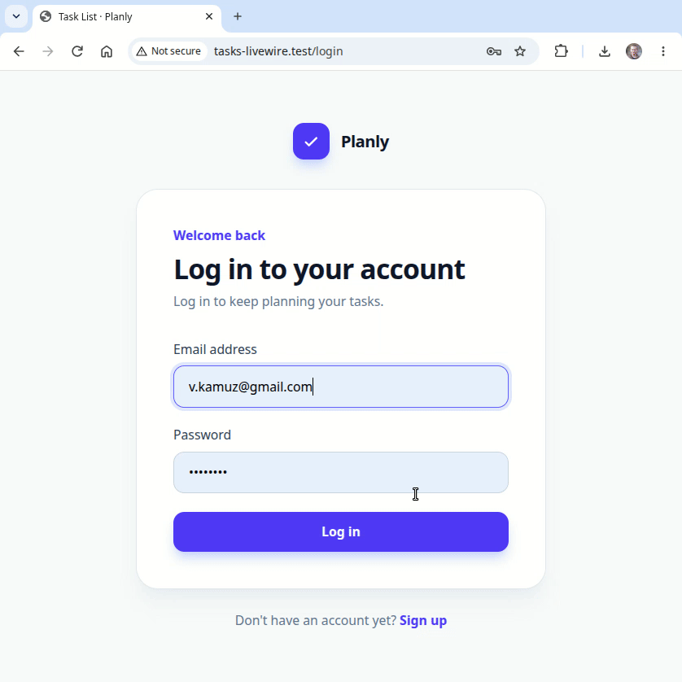

# Simple TODO with Laravel and Livewire

Install:

```
git clone git@github.com:kamuz/tasks-livewire.git
cd tasks-livewire
valet link tasks-livewire
composer update
npm install
cp .env.example .env
php artisan key:generate
php artisan dev
```

Demo:

